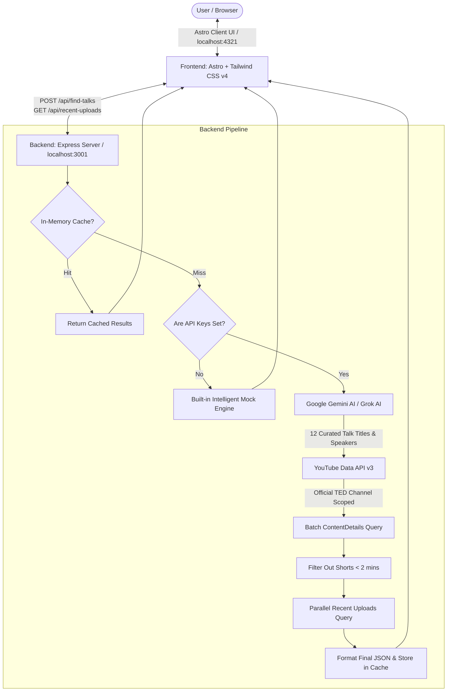

# 🎙️ TED Talk Finder — Intelligent TED Talk Discovery Engine

An AI-powered, production-grade web application designed to find and verify the best, real TED Talks on any given topic. Combining modern generative AI (Google Gemini / xAI Grok) with the official **YouTube Data API v3**, it guarantees authentic, long-form talks directly from the official TED channel with real durations, speakers, thumbnails, and watch links.

---

## 📑 Table of Contents

- [Overview](#-overview)
- [System Architecture](#-system-architecture)
- [Frontend Architecture & Concept](#-frontend-architecture--concept)
- [Backend Architecture & Concept](#-backend-architecture--concept)
- [API Reference](#-api-reference)
- [Environment Variables (.env)](#-environment-variables-env)
- [Prerequisites & Requirements](#-prerequisites--requirements)
- [How to Run Locally (Step-by-Step)](#-how-to-run-locally-step-by-step)
  - [Method 1: Run Both Simultaneously (Recommended)](#method-1-run-both-simultaneously-recommended)
  - [Method 2: Run Frontend & Backend in Separate Terminals](#method-2-run-frontend--backend-in-separate-terminals)
  - [Running in Zero-Config Mock Mode](#running-in-zero-config-mock-mode-no-api-keys-needed)
- [Production Build & Deployment](#-production-build--deployment)
- [Project Directory Structure](#-project-directory-structure)
- [Troubleshooting & FAQs](#-troubleshooting--faqs)

---

## 🌟 Overview

Finding high-quality, relevant TED talks through standard YouTube or Google searches often yields YouTube Shorts, unofficial re-uploads, or loosely related lectures. 

**TED Talk Finder** solves this by using a dual-phase AI + Channel-verification pipeline:
1. **AI Semantic Understanding:** When a user searches for an abstract or specific topic (e.g. *"procrastination"*, *"philosophy of life"*, *"AI ethics"*), Google Gemini / Grok identifies 12 authentic, high-impact talks that strictly match the topic.
2. **Channel-Restricted Verification:** The backend cross-references these suggestions against the official TED YouTube Channel (`channelId: UCAuUUnT6oDeKwE6v1NGQxug`), retrieves video durations in a single batch, and excludes Shorts (< 2 minutes).
3. **Recent Uploads Discovery:** Parallel to curated suggestions, the system retrieves fresh talks published within the last 365 days on the subject.

---

## 🏗️ System Architecture



---

## 🎨 Frontend Architecture & Concept

The frontend is built with **Astro v6**, utilizing an Islands / Static-First architecture paired with **Tailwind CSS v4** and vanilla TypeScript DOM scripting for ultra-fast, zero-bloat performance.

### Key Concepts:
1. **Design System (TED Editorial Language):**
   - Implements the strict specifications documented in `Design.md`.
   - **Color Palette:** Pure black (`#000000`), crisp white (`#FFFFFF`), dark surface (`#1A1A1A`), subtle dividers (`#D8D8D8`), and signature TED Red (`#EB0028`) used selectively for badges, CTAs, and active states.
   - **Typography:** Humanist/Grotesque sans-serif (`Helvetica Neue`, Arial) with heavy, uppercase headlines and clear metadata hierarchy.
   - **Card Design:** 16:9 video thumbnail with duration pill, custom hover play-button overlay, uppercase speaker badge, 2-line clamped title, and direct YouTube watch action.

2. **Client-Side State Machine (`src/pages/index.astro`):**
   - The UI manages 4 distinct visual states:
     - `initial`: Hero search bar, popular topic buttons, and the overall latest TED uploads feed.
     - `loading`: Animated pulsating state displaying the search topic.
     - `error`: Error container with an explicit error explanation and a "Try Again" retry button.
     - `success`: Split view presenting curated topic recommendations (paginated at 6 cards per page with a "Show More" trigger) and recent uploads from the past year.

3. **Performance & SEO:**
   - Pre-rendered static pages with zero initial JavaScript overhead.
   - Dynamic sitemap via `@astrojs/sitemap`.
   - Complete Open Graph tags, Twitter Cards, Google Analytics (gtag.js), and Schema.org JSON-LD structured data (`WebSite`, `SearchAction`).
   - Clean, accessible legal and informative pages: `/about`, `/privacy-policy`, `/terms-and-conditions`, `/404`, and `/500`.

---

## ⚙️ Backend Architecture & Concept

The backend is an **Express.js** service (`server.js`) engineered for resilience, quota conservation, and high throughput.

### Key Concepts:
1. **Intelligent Caching:**
   - In-memory `Map` cache stores full search payloads by topic keyword. Repeating identical or case-insensitive searches consumes **0 API quota** and returns instantly.
2. **Multi-Key Rotation & Quota Guard:**
   - Supports comma-separated keys (`GEMINI_API_KEYS`, `YOUTUBE_API_KEYS`, `GROK_API_KEYS`).
   - If a key triggers quota limits (HTTP 429/403) or fails, the backend seamlessly falls back to the next available key.
3. **Batch Video Duration Optimization:**
   - Instead of firing individual YouTube API requests per video to retrieve duration metadata, the backend collects all `videoId`s and sends **one single** batch request (`/videos?part=contentDetails&id=id1,id2,id3...`). This reduces quota consumption by ~90%.
4. **Shorts & Noise Elimination:**
   - ISO-8601 duration parser converts `PT#M#S` to seconds.
   - Automatically discards entries under 120 seconds to eliminate YouTube Shorts and promotional teasers.
5. **Multi-Phase Relevance Scoring:**
   - For recent uploads, searches TED with date ordering and computes a relevance score (exact phrase match = 3, all words = 2, description match = 1).
6. **Graceful Quota-Exceeded Fallback:**
   - If all YouTube API quotas are fully exhausted, the system does not crash: it converts Gemini's suggestions into direct YouTube search URLs with fallback Unsplash stage thumbnails.
7. **Rate Limiting:**
   - Uses `express-rate-limit` on `/api/find-talks` restricting each IP address to 20 searches every 24 hours.
8. **Contact & Notification Service:**
   - `/api/contact` handles user feedback and automatically delivers formatted HTML emails via **Resend API** if configured.

---

## 📡 API Reference

The backend runs by default at `http://localhost:3001`.

### 1. Find Talks
- **Endpoint:** `POST /api/find-talks`
- **Rate Limit:** 20 requests / 24 hours per IP
- **Body:**
  ```json
  {
    "topic": "philosophy and life"
  }
  ```
- **Response:**
  ```json
  {
    "topic": "philosophy and life",
    "results": [
      {
        "title": "The power of vulnerability",
        "speaker": "Brené Brown",
        "duration": "20 min",
        "thumbnail": "https://img.youtube.com/vi/iCvmsMzlF7o/hqdefault.jpg",
        "videoId": "iCvmsMzlF7o",
        "youtubeLink": "https://www.youtube.com/watch?v=iCvmsMzlF7o",
        "reason": "One of the most watched TED talks about courage and connection.",
        "publishedAt": "2010-12-23T00:00:00Z"
      }
    ],
    "recentResults": [ ... ]
  }
  ```

### 2. Overall Recent Uploads (Homepage Feed)
- **Endpoint:** `GET /api/recent-uploads`
- **Response:** Returns the top 6 latest full-length videos published on the official TED channel.

### 3. Contact Form Submission
- **Endpoint:** `POST /api/contact`
- **Body:**
  ```json
  {
    "name": "Jane Doe",
    "email": "jane@example.com",
    "subject": "Feature Feedback",
    "message": "Love the talk recommendations!"
  }
  ```

---

## 🔑 Environment Variables (.env)

Create a `.env` file in the project root by copying `.env.example`:

```bash
cp .env.example .env
```

| Variable | Description | Default / Example |
| :--- | :--- | :--- |
| `PORT` | Port for Express backend | `3001` |
| `GEMINI_API_KEY` or `GEMINI_API_KEYS` | Google Gemini API key(s) (comma-separated for rotation) | Get from [Google AI Studio](https://aistudio.google.com/) |
| `YOUTUBE_API_KEY` or `YOUTUBE_API_KEYS` | YouTube Data API v3 key(s) (comma-separated for rotation) | Get from [Google Cloud Console](https://console.cloud.google.com/) |
| `GROK_API_KEY` or `GROK_API_KEYS` | *(Optional)* xAI Grok API Key for fallback suggestions | `your_grok_key` |
| `RESEND_API_KEY` | *(Optional)* Resend API key for contact form emails | `re_123456789` |
| `NOTIFICATION_EMAIL` | *(Optional)* Destination inbox for contact submissions | `your_email@gmail.com` |
| `PUBLIC_BACKEND_URL` | Frontend URL pointer to Express backend | `http://localhost:3001` |

---

## 📋 Prerequisites & Requirements

- **Node.js:** `>= 22.12.0` (Required as specified in `package.json`)
- **NPM:** `v10+` or `v11+`

To check your installed version:
```bash
node -v
npm -v
```

---

## 🚀 How to Run Locally (Step-by-Step)

### Step 1: Install Dependencies
Open your terminal in the project root directory and run:
```bash
npm install
```

---

### Method 1: Run Both Simultaneously (Recommended)
You can start both the **Astro Frontend** and the **Express Backend** concurrently with a single command:

```bash
npm run dev:all
```

- **Frontend:** Accessible at [http://localhost:4321](http://localhost:4321)
- **Backend:** Accessible at [http://localhost:3001](http://localhost:3001)

---

### Method 2: Run Frontend & Backend in Separate Terminals

If you prefer watching the logs of each service independently:

#### Terminal 1 — Start the Backend Server:
```bash
npm run server
```
*(Runs with `--watch`, auto-reloading whenever `server.js` changes on port `3001`)*

#### Terminal 2 — Start the Astro Frontend:
```bash
npm run dev
```
*(Runs Astro development server with Hot Module Replacement on port `4321`)*

---

### Running in Zero-Config Mock Mode (No API Keys Needed!)
You do **not** need any API keys to test or demo the app!

If `.env` is absent or the keys contain placeholder values, the backend will automatically activate **Mock Mode**:
- Searching topics like `"procrastination"` or `"stress"` will return rich, realistic mock talk data.
- Searching any other topic will dynamically generate 12 balanced dummy talks.
- The homepage feed will show curated sample talks.

---

## 🚢 Production Build & Deployment

### Build the Frontend
To compile the Astro frontend for production:
```bash
npm run build
```
The static build artifacts will be placed in `./dist/`.

### Preview the Production Build Locally
```bash
npm run preview
```

### Deploy to Cloudflare Pages
The project includes a pre-configured script for Cloudflare Wrangler:
```bash
npm run deploy
```
*(Executes `astro build` and deploys `./dist` to Cloudflare Pages under project `ted-finder`)*

---

## 📁 Project Directory Structure

```text
TED-Finder/
├── .agents/                 # AI assistant workspace customizations & skills
├── .env.example             # Template for API keys & configuration
├── astro.config.mjs         # Astro framework configuration (Tailwind & Sitemap plugins)
├── Design.md                # Official TED-inspired style guide and design tokens
├── package.json             # NPM dependencies, engines, and run scripts
├── README.md                # Complete project documentation & guide
├── server.js                # Express.js backend with AI & YouTube API logic
├── tsconfig.json            # TypeScript configuration
├── public/                  # Static assets, favicons, site.webmanifest
└── src/
    ├── components/
    │   ├── Header.astro     # Responsive site header with navigation links
    │   └── Welcome.astro    # Starter component
    ├── layouts/
    │   └── Layout.astro     # Base HTML layout, SEO meta tags, JSON-LD, analytics
    ├── pages/
    │   ├── 404.astro        # Custom 404 error page
    │   ├── 500.astro        # Custom 500 server error page
    │   ├── about.astro      # About Us story, mission, and methodology
    │   ├── contact.astro    # Contact form page
    │   ├── index.astro      # Primary search interface & card grid
    │   ├── privacy-policy.astro
    │   └── terms-and-conditions.astro
    └── styles/
        └── global.css       # Tailwind CSS v4 setup & custom tokens
```

---

## ❓ Troubleshooting & FAQs

### 1. `YouTube API quota exceeded (Error 429/403)`
- The free tier of YouTube Data API v3 allows 10,000 units per day. Search queries cost 100 units each.
- **Solution:** Add multiple YouTube API keys separated by commas in `.env` under `YOUTUBE_API_KEYS`. The server will rotate automatically.

### 2. Frontend can't connect to Backend (`Failed to fetch`)
- Ensure `server.js` is running on port `3001`.
- If running on a different port or server, set `PUBLIC_BACKEND_URL=http://localhost:<YOUR_PORT>` in your `.env` and restart Astro.

### 3. Node version warning
- Ensure your Node version is `>= 22.12.0`. If using `nvm` (Node Version Manager):
  ```bash
  nvm install 22
  nvm use 22
  ```

---

## 📄 License
This project is for educational and discovery purposes. TED is a registered trademark of TED Conferences LLC. This project is not affiliated with or endorsed by TED Conferences LLC.
